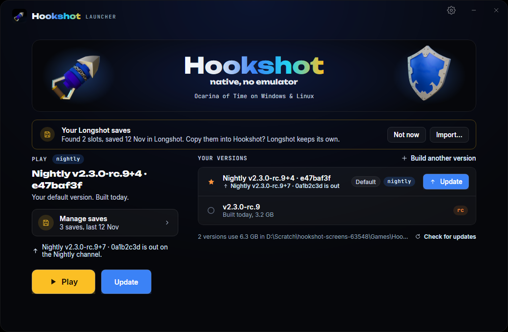

# The Hookshot Launcher

`launcher/` is the Hookshot Launcher: the one program a player downloads to install Hookshot's builder, build the game from
their own copy, keep several versions side by side, update the game and itself, and carry their saves. It is the Magic Bean
team's [Longshot Launcher](https://git.magicbean.dev/MagicBeanDev/LongshotLauncher) (C#, Avalonia 12, .NET 10,
GPL-3.0-or-later, like this tree), written by HumanBean as Hookshot's 3.0 launcher and carried on for Longshot, brought back
here and pointed at Hookshot. [launcher/README.md](../launcher/README.md) is the player's guide and the developer's; this page
is where it came from and how its changes are taken.

<p align="center">
  
</p>

## Where it came from

**Taken whole at:** Longshot Launcher `main` at `9b3d202b0e6398bfa88bfbc3b86295f0decd4d4c` (2026-11-14, "fix(problems):
the crash check reads the game log in logs/ too (#60)"), in the commit that imports it (`feat(launcher): import the Longshot
Launcher at 9b3d202b`). `launcher/Core/Upstream.cs` and the launcher's About name the same commit
(`tests/test_launcher_core.py` holds the three together). The next pull starts there:

```bash
git clone https://git.magicbean.dev/MagicBeanDev/LongshotLauncher.git
git -C LongshotLauncher log --reverse --oneline 9b3d202b..main
```

Take each change by hand (or `git format-patch` and `git am --directory=launcher`), adapted as below, then move the hash
here, in `Upstream.cs` and in `launcher/README.md`, in the same pull request.

## What changed, and how a pick is adapted

| | The Longshot Launcher | The Hookshot Launcher |
|---|---|---|
| Names | `LongshotLauncher.exe`, `LongshotLauncher.*` namespaces, `LONGSHOT_LAUNCHER_*` | `HookshotLauncher.exe`, `HookshotLauncher.*`, `HOOKSHOT_LAUNCHER_*` |
| The other project | imports Hookshot's saves and game settings (`HookshotSaves.cs`, `HookshotSettings.cs`) | imports Longshot's (`LongshotSaves.cs`, `LongshotSettings.cs`): the two names are swapped |
| Releases | Forgejo on git.magicbean.dev, through its Cloudflare CDN | GitHub, the repository the release was built in (`Core/Repository.cs`, the builder's rule), else `notquiteog/Hookshot` |
| The builder | the release's builder zip and `tools.lock` | the release's `hookshot-setup.txt` (Windows, read as `builder/setup/setup.c` reads it) or AppImage (Linux) |
| Versions | Longshot's from v3.0.0, nightlies `nightly-<count>-<commit>` | Hookshot's from v2.0.0, the nightly git describe's `v2.3.0-rc.8-2-gf33ca75d` on the rolling `nightly` release |
| Trust | `SHA256SUMS` signed with the Magic Bean release key | `SHA256SUMS` unsigned (below); the signature check kept, off while no key is built in |
| Look | the 2.x Builder's slate, Inter | the README header's: Unbounded, JetBrains Mono, the 3D Hookshot turning, the shield, black, blue, cyan, gold |
| CI and releases | `.forgejo/workflows`, `scripts/release.py`, `RELEASING.md` | `.github/workflows/launcher.yml` (left out here, as [docs/longshot.md](longshot.md) leaves out Longshot's Forgejo tooling) |

So a pick from the Longshot Launcher turns `Longshot` into `Hookshot` and `Hookshot` into `Longshot` (both at once: a
three-way swap, as the rename did), keeps magicbean.dev and the release key out, and checks that what it reads from Longshot's
builder (`make_game.py`'s options, `@@` lines, environment) is the same in this tree's `nx2/make_game.py`, which
`tests/test_launcher_core.py` compares where it can (the languages, the DLSS and FSR 4 licence commits, the player id).

## Releases and channels

Hookshot and the launcher are released from the same repository, each on its own three channels:

| Channel | Hookshot (the builders) | The launcher |
|---|---|---|
| `stable` | the newest non-prerelease `vX.Y.Z` | the newest `launcher-vX.Y.Z` |
| `rc` | the newest `vX.Y.Z-rc.N` or `vX.Y.Z` | the newest `launcher-vX.Y.Z-rc.N` or `launcher-vX.Y.Z` |
| `nightly` | the rolling `nightly` release; its version is the `tag` line of its `hookshot-setup.txt` (Windows) or `hookshot-linux.txt` (Linux) | the rolling `launcher-nightly` release; its version, `nightly-<commits on main>-<commit>`, is in its files' names |

A fork with no release tags yet (NoobyGains/Hookshot today) has only the nightly: its versions are `v0.0.0-0-g<commit>`
(Windows) and the commit alone (Linux), which are not ordered, so the launcher offers the rolling nightly whenever it differs
from the build's. Where a channel has no release, the home says "There is no release on this channel yet" and starts on one
that has.

One check reads the release list once (`GET /repos/<owner>/<repo>/releases`, one API call for the three channels; GitHub
allows 60 an hour from one address without an account, and the launcher says so when the limit is reached); everything else
comes from github.com's download links. Each version's builder is installed apart in the launcher's home
(`toolchains/<version>`), from the release's own list: on Windows every part `hookshot-setup.txt` names, each checked against
the SHA-256 and size the list gives and unpacked as the setup unpacks it (a part another installed version has is kept, not
downloaded again); on Linux the release's AppImage, which carries every tool, unpacked with its own `--appimage-extract`.
`make_game.py` is then run as the builders run it (`Runner.Info` on Windows, `builder/linux/AppRun` on Linux): the same
arguments, environment and `@@` progress lines, so the builder needed no change. (`HookshotBuilder.exe --cli` was not used:
it drops `HOOKSHOT_NGX_SDK` and `HOOKSHOT_FFX_SDK`, so DLSS could not be built through it.)

The launcher's own update follows the Longshot Launcher's: the new file downloaded beside the current one and checked, started
once with `--self-check`, then swapped in; `--rollback` puts the previous one back. Its nightly is made and published by
`.github/workflows/launcher.yml` on every push to `main` that touches it.

## Trust

Every file the launcher installs is checked against its release's `SHA256SUMS`, and each Windows part against the SHA-256 its
setup list gives (the list itself checked against `SHA256SUMS`). **Hookshot's releases are not signed yet** ("a signed
Builder" is on the roadmap), so `SHA256SUMS` is taken as GitHub serves it over https: the checks catch a damaged or
replaced download, not a release made by someone who controls the repository. The Longshot Launcher's signature check is kept
(`Core/ReleaseTrust.cs`) and is off only because no key is built in. To turn it on, once:

```bash
openssl ecparam -name prime256v1 -genkey -noout -out release.pem     # the private key: a CI secret, never in a repository
openssl ec -in release.pem -pubout -out release.pub.pem
```

put the public key's base64 (between the PEM lines) in `ReleaseKeys.BuiltIn`, release that launcher, and from then on sign
every release's `SHA256SUMS` in CI (`openssl dgst -sha256 -sign release.pem SHA256SUMS | base64 -w0 > SHA256SUMS.sig`). A
launcher with a key built in refuses any release without a valid `SHA256SUMS.sig`. `HOOKSHOT_LAUNCHER_TRUST=<public .pem>`
tries a release signed with a test key.

**Known problem, 2026-11-14:** the `hookshot-setup.txt` of NoobyGains/Hookshot's nightly and of upstream's v2.3.0-rc.9 name
two parts on the deleted upstream repository (`HookshotBuilder-emsdk-b4c8fc476654.zip`,
`HookshotBuilder-wgpu-native-a3b3d8253fba.zip`), which now answer 404, so a Windows install with nothing installed yet stops
at them, in the launcher and in `HookshotBuilder.exe` alike. The launcher also looks for a `builder-parts` part under its
name on this repository's and `notquiteog/Hookshot`'s `builder-parts` releases, so uploading the two files there again fixes
it without a new list; the release scripts should stop carrying the old links forward.

## Saves

Every build shares one save folder: `%APPDATA%\Hookshot\save\<user id>` on Windows, which the launcher starts every build
with (`--user %APPDATA%\Hookshot`), and `~/.local/share/hookshot/save/<user id>` on Linux, where the game looks by itself. On
Windows the saves earlier builds kept in their own game folders (`<game folder>\user\save`, the 2.x Builder's
`%USERPROFILE%\Games\Hookshot`) are brought in once, the newest kept, all backed up first, the old folders renamed aside and
never deleted. The Saves page imports from the emulators and NX2navi ([saves.md](saves.md) has where each keeps them) and
**from Longshot**: `%APPDATA%\Longshot\save` (the Longshot Launcher's), its old game folders, or
`~/.local/share/longshot/save`. Every import checks the save file by file, copies and never moves, backs up the save it
replaces, asks before replacing one, and is refused while Hookshot, Longshot or an emulator runs.

## Checks

```bash
python -I launcher/tests/test_launcher_core.py     # the core, over made-up releases, builders and saves (no game, no network)
python -I tests/test_launcher_repository.py         # the launcher's repository is the builder's, and CI stamps it
cd launcher && dotnet run --project tools/screens -c Release -- <folder>   # every page drawn, with no screen
```
