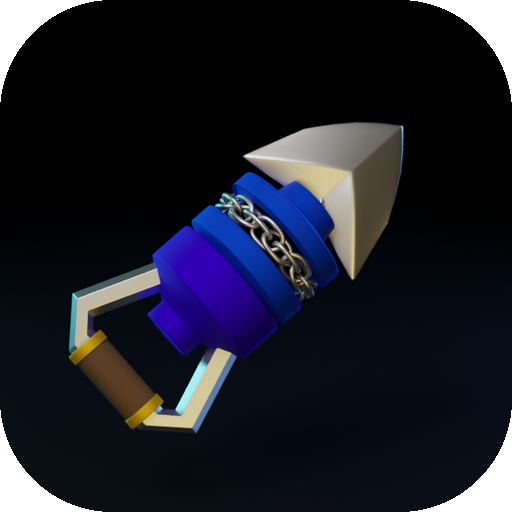
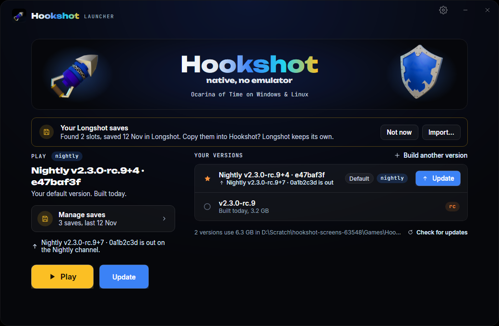
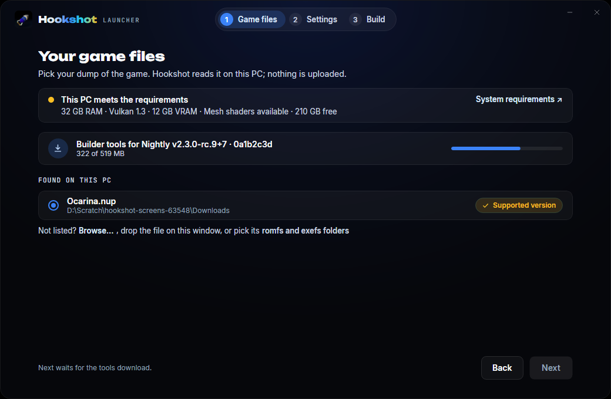
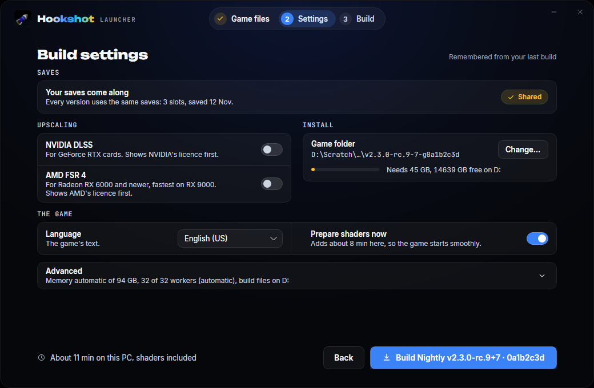
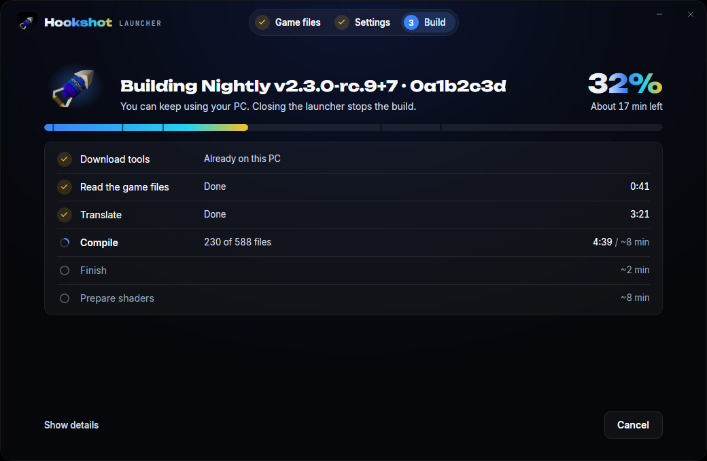
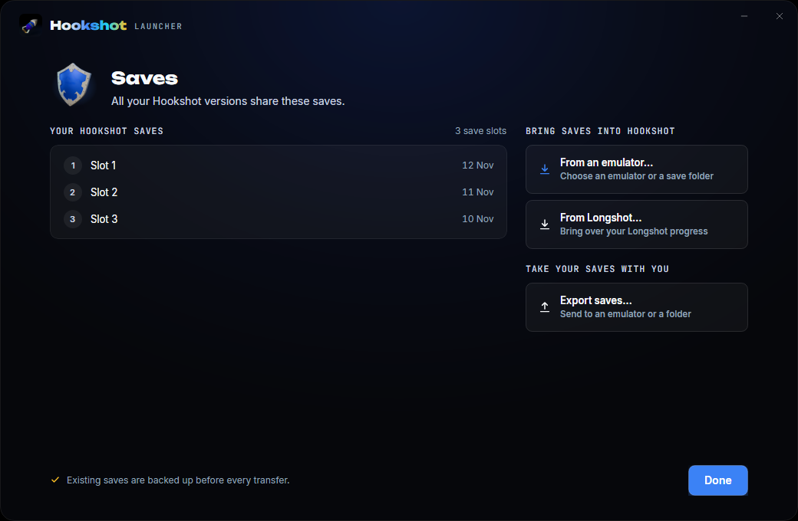
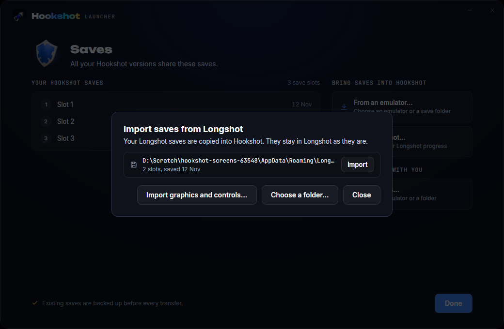

<h1 align="center">
  <br>
  Hookshot Launcher
</h1>

<h4 align="center">Installs, builds, updates and starts <a href="../readme.md">Hookshot</a>, which runs Ocarina of Time natively on Windows &amp; Linux.</h4>

<p align="center">
  <a href="#what-it-does">What it does</a> |
  <a href="#download">Download</a> |
  <a href="#installing">Installing</a> |
  <a href="#using-it">Using it</a> |
  <a href="#saves">Saves</a> |
  <a href="#updates-channels-and-trust">Updates</a> |
  <a href="#build-from-source">Build from source</a> |
  <a href="#credits">Credits</a> |
  <a href="#license">License</a>
</p>

The Hookshot Launcher is the one program a player needs. It installs Hookshot's builder, builds the game **on your PC, from
your own copy of the game**, starts it, and keeps the game and itself up to date. It is based on the Magic Bean team's
[Longshot Launcher](https://git.magicbean.dev/MagicBeanDev/LongshotLauncher) (commit `9b3d202b`), written by HumanBean as
Hookshot's 3.0 launcher and carried on for Longshot; [docs/launcher.md](../docs/launcher.md) says what changed and how its
later changes are taken.

<p align="center">
  
</p>

> [!NOTE]
> Nothing of the game is in the launcher or downloaded by it. It downloads Hookshot's builder, which builds the game from the
> copy you own.

## What it does

| | |
|---|---|
| **Builds the game** | A three-step wizard: it finds your game files while that version's builder downloads, then the settings (DLSS, FSR 4, language, where the game goes), then the build with one progress bar |
| **Several versions side by side** | Keep a release and a nightly; Play starts the default one; Set as default, Saves, Open folder and Delete for each |
| **Three channels** | `stable`, `rc` (release candidates) and `nightly`, chosen per build and, apart from that, for the launcher itself |
| **Installs Hookshot's builder** | For each version, from Hookshot's GitHub release: every file checked by its SHA-256 before it is used |
| **Updates the game** | Offers each build its channel's newest version and builds it from the game files the build kept |
| **Updates itself** | From its own releases, checked and started once before it replaces itself; `--rollback` puts the previous one back |
| **Saves** | One save folder for every build; imports saves from Longshot, NX2navi and the emulators, exports them; backs up first; never while a game runs |
| **16 languages, installer** | Per-user install (Start menu, Apps &amp; features, uninstall), portable mode, Linux AppImage with an applications-menu entry |

<table>
  <tr>
    <td width="50%"></td>
    <td width="50%"></td>
  </tr>
  <tr>
    <td width="50%"></td>
    <td width="50%"></td>
  </tr>
</table>

## Download

The launcher's own releases are on this repository's [releases page](https://github.com/notquiteog/Hookshot/releases): the
rolling **`launcher-nightly`** pre-release (every change to `main` that touches `launcher/`), and `launcher-vX.Y.Z` releases
once there are any. Each has:

- **Windows 10 and 11 (x64):** `HookshotLauncher-<version>-windows-x64-setup.exe`. Start it, then choose *Install* or *Run
  portable*.
- **Windows, portable:** `HookshotLauncher-<version>-windows-x64-portable.zip`. Unzip it anywhere and start
  `HookshotLauncher.exe`.
- **Linux and Steam Deck (x86-64):** `HookshotLauncher-<version>-x86_64.AppImage`. Make it executable (`chmod +x`) and start it.
- `SHA256SUMS`: every file's SHA-256.

A fork's launcher, built by the fork's workflow, follows the fork's releases. The launcher is not code-signed yet: Windows may
warn about an unknown program on its first start (*More info*, then *Run anyway*).

## Installing

**Windows.** The first start of the setup file asks: **Install** copies it to
`%LOCALAPPDATA%\Programs\HookshotLauncher\HookshotLauncher.exe` (for your user, no administrator rights), adds a *Hookshot
Launcher* shortcut to the Start menu and an entry in *Apps &amp; features*, then starts the installed copy; **Run portable**
puts a file named `portable` beside the program and keeps everything in a `HookshotLauncher-data` folder beside it. Its data
otherwise goes in `%LOCALAPPDATA%\HookshotLauncher`. *Settings > Apps > Installed apps > Hookshot Launcher > Uninstall* takes
it away (your game folders and saves stay).

**Linux and the Steam Deck.** The AppImage needs no installing. *Settings > Applications menu* adds it to the applications
menu. A folder named after the AppImage with `.home` added beside it makes it portable. Its data otherwise goes in
`~/.local/share/hookshot/launcher`.

One launcher at a time: a second start brings the open one's window forward.

## Using it

1. **Build** (or later **Build another version**) opens the wizard. Pick the channel: *Stable* for playing, *Release
   candidate* to try the next version, *Nightly* for the newest changes.
2. **Game files**: the launcher looks for your dump on this PC; point it at the `.nup` file or the `romfs` and `exefs` folders
   if it doesn't find it. Meanwhile it downloads that version's builder and checks this PC against the
   [requirements](../readme.md#what-you-need).
3. **Settings**: where the game goes, the language, DLSS or FSR 4 (their licences are shown first), and Advanced.
4. **Build**: 15 to 45 minutes the first time, shaders included. An update compiles only what changed.
5. **Play**. Ready can also make desktop and menu shortcuts, which start the default version.

The cog on the home opens the launcher's settings: its language, the channel for new builds, the launcher's own channel,
where builds go, the build files folder (and *Free up space*), the update check at start, and About.

## Saves

Every build shares one save folder: `%APPDATA%\Hookshot` on Windows, `~/.local/share/hookshot` on Linux. On Windows the
launcher brings in, once, the saves earlier builds kept in their own game folders, keeping the newest after backing them all
up. The **Saves** page imports saves from **Longshot** (where the Longshot Launcher keeps them, `%APPDATA%\Longshot` or
`~/.local/share/longshot`, or its old game folders), from NX2navi and from Lichii, Eden and the other emulators, and exports
them back. Every copy checks the save, copies and never moves it, and backs up what it replaces first; nothing is copied
while Hookshot, Longshot or an emulator runs. **Import graphics and controls** brings Longshot's compatible game settings into
a Hookshot version, with its own confirmation and backup. Where every program keeps its saves: [docs/saves.md](../docs/saves.md).

<p align="center">
  
</p>

## Updates, channels and trust

Hookshot and the launcher are released from this repository, each on three channels: `stable` (`vX.Y.Z`; the launcher's
`launcher-vX.Y.Z`), `rc` (release candidates and stables) and `nightly` (the rolling `nightly` and `launcher-nightly`
releases). *Channel for new builds* is the channel a new build follows; until you pick one it follows the launcher's. A
channel with no release yet says so. *Launcher updates* is the channel the launcher updates itself from.

Every file is checked against its release's `SHA256SUMS` before it is used. **Hookshot's releases are not signed yet**, so
`SHA256SUMS` is taken as GitHub serves it over https; the launcher keeps the Longshot Launcher's signature check, off until a
release key is built in ([docs/launcher.md](../docs/launcher.md#trust) says how to turn it on). The launcher never goes to a
lower version by itself.

## Build from source

The [.NET 10 SDK](https://dotnet.microsoft.com/download), on Windows or Linux, from this repository:

```sh
cd launcher
dotnet build HookshotLauncher.slnx
dotnet run --project App
```

`scripts/package.sh <tag> <out folder>` makes the three release files on Linux (CI: `.github/workflows/launcher.yml`).
`scripts/make_art.py` remakes the icon and the transparent shield from `assets/brand` after the brand art changes.

### Layout

| | |
|---|---|
| `Core/` | `HookshotLauncher.Core`: the logic, no UI and no package. Versions and channels (`Versions`), the releases on GitHub (`Releases`, `ReleaseManifest`, `ReleaseTrust`, `Repository`), the builder's setup lists (`SetupList`) and each version's builder (`Toolchains`, `ToolsSource`), its own update (`SelfUpdate`), `builds.json` (`BuildRegistry`), make_game.py's command line, `@@` lines, run and check (`MakeGameCommand`, `MakeGameProtocol`, `MakeGameRun`), the game files found on this PC (`GameFiles`), update offers (`UpdatePolicy`), saves (`Saves`, a port of `scripts/oot_saves.py`; `LongshotSaves`, `LongshotSettings`), installed or portable (`LauncherLayout`, `Installer`), and what it is based on (`Upstream`) |
| `Core/Lang/` | The launcher's translations, one catalog per language (`Tr`) |
| `App/` | `HookshotLauncher`: the Avalonia window. `ViewModels/`, `Views/` (`HeroBanner` is the README header, live), `Controls/` (`Turntable`, the 3D Hookshot turning), `App.axaml` (the palette and the styles), `Assets/` (the icon, the shield, Inter); the turning sheet and the brand fonts come from `../assets` |
| `tests/` | `test_launcher_core.py` (builds `launcher_core/`, which compiles `Core/` and checks it), `fixtures/` (a test-signed release, fake Longshot saves) |
| `tools/screens/` | Every page drawn with no screen: the pictures in `docs/images/launcher` and CI's check that every page draws |
| `scripts/` | `package.sh` (the release files), `make_art.py` and `make_icon.py` (the pictures), `translations.py` (the catalogs against the window's texts) |

### Environment and command line

| | |
|---|---|
| `HOOKSHOT_LAUNCHER_HOME=<folder>` | The launcher's home (`builds.json`, `settings.json`, `toolchains/`) somewhere else, for trying it out |
| `HOOKSHOT_LAUNCHER_REPOSITORY=<owner/name>` | Releases from another GitHub repository (a build from a checkout follows `notquiteog/Hookshot`) |
| `HOOKSHOT_LAUNCHER_OFFLINE=1` | No update check |
| `HOOKSHOT_LAUNCHER_TRUST=<public key .pem>` | Trust a release key, for a release signed with a test key (and require signatures) |
| `HOOKSHOT_LAUNCHER_REDUCED_MOTION=1` | No animations (also when the desktop asks for less motion) |
| `--launch <folder>` | Opens on that build |
| `--play [<folder>]` | Starts the game with no window (the shortcuts use it) |
| `--self-check` | Prints `HookshotLauncher <version>` (a new launcher answers it before it is put in place) |
| `--rollback` | Puts back the launcher the last update replaced |
| `--install`, `--uninstall` | Windows: installs this launcher without asking; uninstalls the installed one |

### Tests

```sh
python -I tests/test_launcher_core.py
python -I ../tests/test_launcher_repository.py
dotnet run --project tools/screens -c Release -- <folder>
```

The first builds `tests/launcher_core`, which compiles the core with no package and checks it with no game, no network and no
window: versions and channels, releases (channels, refusals, hashes, signatures, setup lists), the builder's install, the
launcher's own update, install and uninstall with a fake registry, the saves and the Longshot import over fake saves, and the
rest over temporary folders. It also checks the launcher's copies against this repository: `make_game.py`'s languages, the DLSS
and FSR 4 licence commits, the player id the game opens. Every text the window shows is in `Core/Lang/<code>.json`
(`python -I scripts/translations.py` lists what each catalog lacks).

## Credits

- **HumanBean** (hckrman101 on GitHub) and **the Magic Bean team**: the [Longshot Launcher](https://git.magicbean.dev/MagicBeanDev/LongshotLauncher),
  first written as Hookshot's 3.0 launcher, which this is.
- **NotRexed and the Hookshot contributors**: Hookshot and its 2.x Builders, whose save tool (`scripts/oot_saves.py`) and game
  file finder the launcher carries on.
- **The art**: the 3D Hookshot and the blank Hyrule shield are renders of fan-made models (the Hookshot by DTStheTDS;
  [assets/brand/README.md](../assets/brand/README.md) has the credits), lit and rendered for this project; nothing is taken
  from the game.
- **[Avalonia](https://avaloniaui.net)** (MIT): the window toolkit.
- **[Inter](https://rsms.me/inter/)** by Rasmus Andersson, **Unbounded** and **JetBrains Mono** (SIL Open Font License 1.1;
  `App/Assets/Fonts/Inter-LICENSE.txt`, `assets/brand/fonts/OFL-*.txt`): the type.
- **[AppImage](https://appimage.org)**'s appimagetool and runtime (MIT): the Linux package.

## License

The Hookshot Launcher is free software under the [GNU General Public License, version 3 or later](LICENSE)
(GPL-3.0-or-later), as Hookshot and the Longshot Launcher are.

    Copyright (C) 2026 the Longshot contributors
    Copyright (C) 2026 the Hookshot contributors

The fonts keep their own licences. The launcher is an unofficial fan project, not affiliated with or endorsed by Nintendo.
The Legend of Zelda and Ocarina of Time are trademarks of Nintendo.
