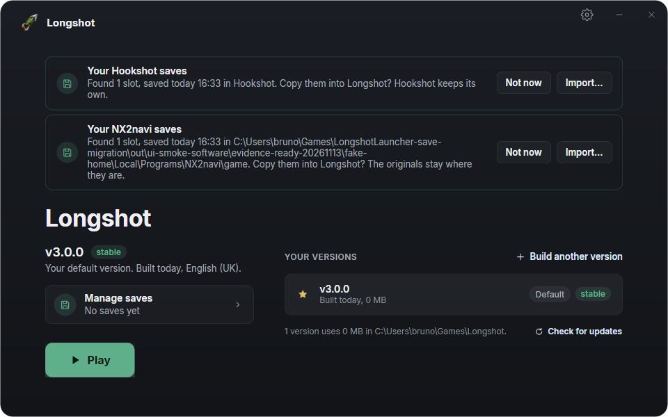
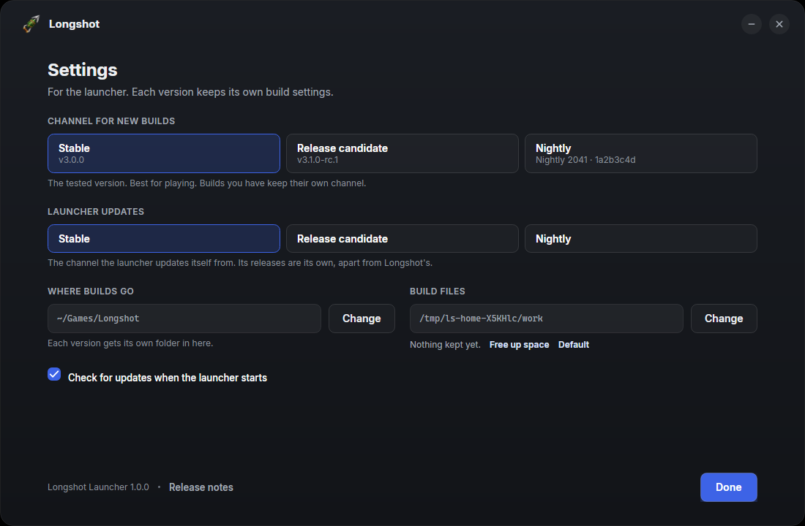
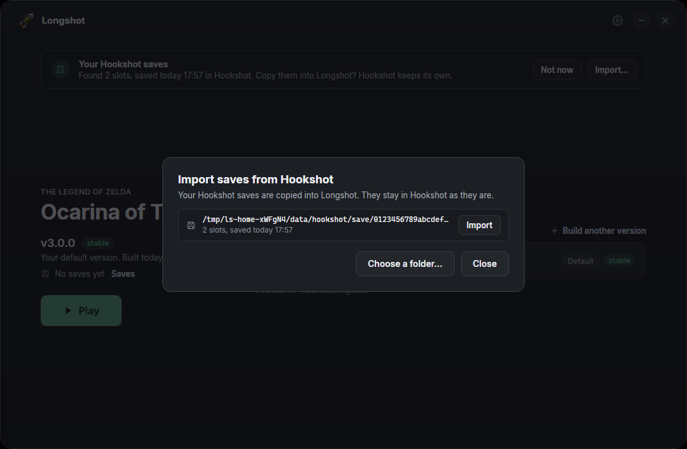
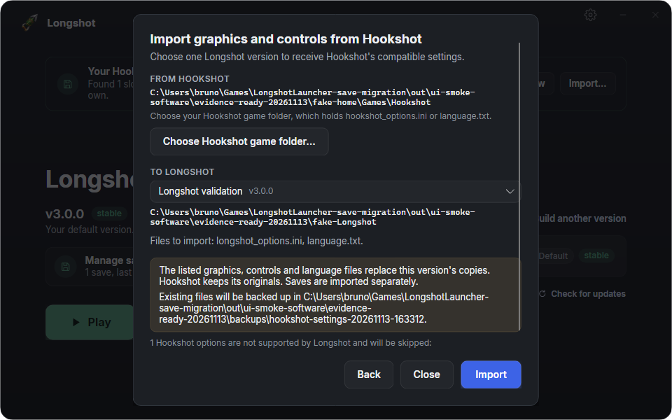

<h1 align="center">
  <br>
  <a href="https://git.magicbean.dev/MagicBeanDev/LongshotLauncher">
  
</a>

  <br>
  <b>Longshot Launcher</b>
  <br>
</h1>

<h4 align="center">Installs, builds, updates and starts <a href="https://git.magicbean.dev/MagicBeanDev/Longshot">Longshot</a>, which runs a supported console game natively on Windows & Linux.
</h4>


<p align="center">
  <a href="https://longshot.magicbean.dev/"><b>Website</b></a> |
  <a href="https://discord.gg/magicbean"><b>Discord</b></a> |
  <a href="#what-it-does">What it does</a> |
  <a href="#download">Download</a> |
  <a href="#installing">Installing</a> |
  <a href="#using-it">Using it</a> |
  <a href="#saves">Saves</a> |
  <a href="#updates-and-channels">Updates</a> |
  <a href="#build-from-source">Build from source</a> |
  <a href="#credits">Credits</a> |
  <a href="#license">License</a>
</p>

<p align="center">This website is our Git hosting, similar to GitHub.</p>

The Longshot Launcher is the one program players download to get [Longshot](https://git.magicbean.dev/MagicBeanDev/Longshot).
It installs Longshot's builder, builds the game **on your PC, from your own copy of the game**, starts it, and keeps
the game and itself up to date. It is a separate project from Longshot, with its own repository and its own releases.

<p align="center">
  
</p>

> [!NOTE]
> Nothing of the game is in the launcher or downloaded by it. It downloads Longshot's builder, which builds the game from
> the copy you own. Don't ask where to get the game.

Discord: https://discord.gg/magicbean

## What it does

| | |
|---|---|
| **Builds the game** | A three-step wizard: it finds your game files while that version's builder downloads, then the settings (DLSS, FSR 4, language, where the game goes), then the build with one progress bar |
| **Several versions side by side** | Keep a stable build and a nightly; Play starts the default one; Set as default, Saves, Open folder and Delete for each |
| **Three channels** | `stable`, `rc` (release candidates) and `nightly`, chosen per build and, apart from that, for the launcher itself |
| **Installs Longshot's builder** | For each version, from Longshot's signed release: every file checked against its SHA-256 before it is used |
| **Updates the game** | Offers each build its channel's newest version and builds it from the game files the build kept |
| **Updates itself** | From its own signed releases, checked and tested before it replaces itself; `--rollback` puts the previous one back |
| **Saves** | One save folder for every build, imports saves from emulators and from Hookshot, exports them to emulators ([docs/saves.md](docs/saves.md)) |

## Download

# ⬇️ Download Longshot Launcher

### [🪟 &nbsp;Download for Windows](https://longshot.magicbean.dev/download/launcher/windows)

### [🐧 &nbsp;Download for Linux (AppImage)](https://longshot.magicbean.dev/download/launcher/linux)

Windows without installing: [portable zip](https://longshot.magicbean.dev/download/launcher/windows-portable) · Not sure? [longshot.magicbean.dev/download](https://longshot.magicbean.dev/download) picks for your computer.

These links always give the newest launcher: the stable one, or until there is one, the release candidate, then the
nightly. To pick a channel:

- **Stable** (for playing): [Windows](https://longshot.magicbean.dev/download/launcher/stable/windows) · [portable zip](https://longshot.magicbean.dev/download/launcher/stable/windows-portable) · [Linux](https://longshot.magicbean.dev/download/launcher/stable/linux) · [release page](https://longshot.magicbean.dev/download/launcher/stable)
- **Release candidate** (the next version, before it is stable): [Windows](https://longshot.magicbean.dev/download/launcher/rc/windows) · [portable zip](https://longshot.magicbean.dev/download/launcher/rc/windows-portable) · [Linux](https://longshot.magicbean.dev/download/launcher/rc/linux) · [release page](https://longshot.magicbean.dev/download/launcher/rc)
- **Nightly** (every change, untested): [Windows](https://longshot.magicbean.dev/download/launcher/nightly/windows) · [portable zip](https://longshot.magicbean.dev/download/launcher/nightly/windows-portable) · [Linux](https://longshot.magicbean.dev/download/launcher/nightly/linux) · [release page](https://longshot.magicbean.dev/download/launcher/nightly)

Every release is on [the releases page](https://git.magicbean.dev/MagicBeanDev/LongshotLauncher/releases). The files:

- **Windows 10 and 11 (x64):** `LongshotLauncher-<version>-windows-x64-setup.exe`. Start it, then choose *Install* or
  *Run portable* ([Installing](#installing)).
- **Windows, portable:** `LongshotLauncher-<version>-windows-x64-portable.zip`. Unzip it anywhere (a USB stick) and start
  `LongshotLauncher.exe`.
- **Linux and Steam Deck (x86-64):** `LongshotLauncher-<version>-x86_64.AppImage`. Make it executable (`chmod +x`) and
  start it.

This is the one download: the launcher installs Longshot's builder for you. The builder files on
[Longshot's releases](https://git.magicbean.dev/MagicBeanDev/Longshot/releases) are for the launcher, not for you.

All of them are in the release's signed `SHA256SUMS`. After that the launcher updates itself. Its numbers are its own:
Longshot's start at v3.0.0, the launcher's at v1.0.0.

> [!TIP]
> Windows may warn about an unknown program on its first start (the program is not code-signed yet). Choose *More info*,
> then *Run anyway*.

## Installing

There is no installer program: the launcher installs itself.

**Windows.** The first start of the setup file asks:

- **Install** copies it to `%LOCALAPPDATA%\Programs\LongshotLauncher\LongshotLauncher.exe` (for your user only, no
  administrator rights), adds a *Longshot Launcher* shortcut to the Start menu and an entry in *Apps & features*
  (publisher Magic Bean), then starts the installed copy. After each of its own updates it makes the Start menu shortcut
  (and the *Longshot* shortcuts it made) again, so they start the updated program. Its data goes in `%LOCALAPPDATA%\LongshotLauncher`. You can
  delete the setup file afterwards. `LongshotLauncher-<v>-windows-x64-setup.exe --install` does the same without asking.
- **Run portable** puts a file named `portable` beside the program, and from then on the launcher keeps everything in a
  `LongshotLauncher-data` folder beside it: its settings, its list of builds, the builder's tools, the build files, and by
  default the builds and the save backups too. It never writes the registry or makes a shortcut of its own. The portable
  zip has the `portable` file in it already, so it never asks.

**Uninstalling** (Windows): *Settings > Apps > Installed apps > Longshot Launcher > Uninstall*, which runs
`LongshotLauncher.exe --uninstall`. It removes the program, its Start menu shortcut, the *Longshot* shortcuts it made, and
its *Apps & features* entry. It asks whether to delete its data too; your builds' game folders and your saves are never
deleted, even when they are inside it.

**Updates keep the kind.** An installed launcher updates its installed `LongshotLauncher.exe`, from the release's setup
file; a portable one takes `LongshotLauncher.exe` out of the release's portable zip and updates itself in place, beside its
`portable` file. Either way the file keeps the name it was installed or started as.

**Linux and the Steam Deck.** The AppImage needs no installing. *Settings > Applications menu > Add to applications menu*
writes `~/.local/share/applications/longshot-launcher.desktop` and its icon, starting the AppImage where it is now; add it
again after moving the AppImage, or *Remove* it. **Portable on Linux** is the AppImage convention: make a folder named after
the AppImage with `.home` added (`LongshotLauncher-v1.0.0-x86_64.AppImage.home`) beside it, and the launcher keeps its data
there. (The AppImage runtime then also points `$HOME` there, for everything the launcher starts.)

**One launcher at a time.** A second start of the launcher brings the open one's window forward instead (one per data
folder: a portable launcher and an installed one can run side by side).

**If an update was cut short on Windows** (the PC lost power during the swap), the launcher puts the earlier one back the
next time it starts. If `LongshotLauncher.exe` itself is missing, rename `LongshotLauncher.exe.old` beside it back to
`LongshotLauncher.exe`.

## Using it

1. **Build another version** (or, the first time, **Build the game**) opens the wizard. Pick the channel: *Stable* for
   playing, *Release candidate* to try the next version, *Nightly* for the newest changes.
2. **Game files**: the launcher looks for your dump on this PC; point it at the folder if it doesn't find it.
3. **Settings**: where the game goes, the language, and DLSS or FSR 4 (their licences are shown first). Your saves come
   along: every build shares them.
4. **Build**: about 15 to 30 minutes the first time, shaders included. An update compiles only what changed.
5. **Play**. Ready can also make desktop and menu shortcuts, which start the default version.

The cog on the home opens the launcher's settings: the **launcher's language**, the channel for new builds, the
**launcher's own channel**, where builds go, the build files folder (and *Free up space*), the update check at start, and on
Linux the launcher's entry in the applications menu.

The launcher speaks the game's sixteen languages. It starts in the system's (Windows' display language; on Linux `LANGUAGE`,
`LC_ALL`, `LC_MESSAGES` or `LANG`), else English, until one is picked in Settings, and a pick changes the window at once. The
game's own language is apart from it: a build setting (step 2), as before.

<p align="center">
  
</p>

## Saves

Every build shares one save folder (`%APPDATA%\Longshot` on Windows, `~/.local/share/longshot` on Linux). On Windows the
launcher brings in, once, the saves each build kept in its own folder before, and the 2.x Builder's, keeping the newest
after backing them all up ([docs/saves.md](docs/saves.md#saves-from-before-windows)). The **Saves** page imports saves from
Lichii, Eden, NX2navi and the other emulators, and exports them back. You can import before playing Longshot for the first
time. Every copy backs up what it replaces first.

**Coming from NX2navi?** The home offers to import saves found in its usual game folder. Choose the profile and confirm
the import; the originals stay where they are. Portable or custom installs can be chosen by hand.

**Coming from Hookshot?** The launcher finds Hookshot's saves and offers once to copy them in, or use
*Saves > Import from Hookshot…*. It copies them and never moves them, so Hookshot keeps its own. It checks the files
first, and it asks, and backs up, before it replaces a Longshot save. **Import graphics and controls…** separately brings
compatible Hookshot game settings into the Longshot version you choose, with its own confirmation and backup.

<p align="center">
  
  
</p>

All of it, with where every save lives: [docs/saves.md](docs/saves.md). Longshot's own
[saves guide](https://git.magicbean.dev/MagicBeanDev/Longshot/src/branch/main/docs/saves.md) has the same from the command
line (`scripts/oot_saves.py import|export`).

## Updates and channels

Longshot and the launcher are released apart, from their own repositories, each on three channels:

| Channel | Made from | For |
|---|---|---|
| `stable` | a tag `vX.Y.Z` | playing |
| `rc` | a tag `vX.Y.Z-rc.N` (and every stable) | trying the next version before it is released |
| `nightly` | every change to `main` | the newest changes, untested |

**Two choices in Settings.** *Channel for new builds* is the channel of Longshot a new build follows (each build keeps
its own). Until you pick one, it follows the launcher's channel: a nightly launcher builds nightlies. *Launcher updates* is the channel the launcher updates **itself** from: LongshotLauncher's own stable, rc or
nightly, apart from any build's. It starts on the channel of the launcher you installed.

Every release's `SHA256SUMS` is signed with the release key, which the launcher has built in. The launcher installs nothing
whose signature or SHA-256 does not check out, and never goes to a lower version by itself. A new launcher is downloaded
beside the current one and checked. It is then started once with `--self-check`, and only then swapped in.
`--rollback` puts the previous launcher back. How releases are made and checked: [docs/releases.md](docs/releases.md);
how to make one: [RELEASING.md](RELEASING.md).

## Build from source

The [.NET 10 SDK](https://dotnet.microsoft.com/download), on Windows or Linux:

```sh
git clone --depth 1 https://git.magicbean.dev/MagicBeanDev/LongshotLauncher.git
cd LongshotLauncher
dotnet build LongshotLauncher.slnx
dotnet run --project App
```

`scripts/package.sh <tag> <out folder>` makes the two release programs on Linux (a test build unless CI signs it).

### Layout

| | |
|---|---|
| `Core/` | `LongshotLauncher.Core`: the logic, no UI and no package. Versions and channels (`Versions`), the signed releases of Longshot and of the launcher (`Releases`, `ReleaseTrust`, `ReleaseManifest`), its own update (`SelfUpdate`), each version's builder and its tools.lock (`Toolchains`, `ToolsSource`, `ToolsLock`), game folders, `builds.json` (`BuildRegistry`), remembered settings, make_game.py's command line, `@@` lines, run and check (`MakeGameCommand`, `MakeGameProtocol`, `MakeGameRun`), the game files found on this PC (`GameFiles`), update offers (`UpdatePolicy`), saves (`Saves`, a port of Longshot's `scripts/oot_saves.py`; `SaveText`) and Hookshot's (`HookshotSaves`), disk space (`Disk`), this PC (`SystemInfo`), shortcuts (`Shortcuts`), installed or portable (`LauncherLayout`, `Installer`), one launcher per home (`InstanceLock`), the launcher's home and command line |
| `Core/Lang/` | The launcher's translations, one catalog per language (`Tr`, [Translations](#translations)) |
| `App/` | `LongshotLauncher`: the Avalonia window. `ViewModels/` (one per page and dialog), `Views/` (one .axaml each, compiled bindings), `Controls/` (icons, bars and spinner), `App.axaml` (the palette and the styles), `Assets/` (the Longshot logo and icon, the Inter font with its licence) |
| `tests/` | `test_launcher_core.py` (builds `launcher_core/`, which compiles `Core/` and checks it), `test_release.py` (`scripts/release.py`), `fixtures/` (signed test releases, fake Hookshot saves) |
| `scripts/` | `package.sh` (both release programs, from Linux), `make_icon.py` (`App/Assets/longshot.ico` from the logo), `release.py` (the signed release files, the keys, the uploads; the same file as Longshot's), `translations.py` (the window's texts against each catalog) |
| `.forgejo/workflows/` | `ci.yml` (compile and test, every pull request), `release.yml` (the nightly from `main`, a release from a `v*` tag) |
| `docs/` | [releases.md](docs/releases.md), [saves.md](docs/saves.md), and the screenshots in this README |

### Environment and command line

| | |
|---|---|
| `LONGSHOT_LAUNCHER_DEBUG_SLOW=<ms>` | A Debug build only: waits that long before each answer from git.magicbean.dev and a tenth of it after each MB downloaded, to see the busy states (the launcher's update, the check, the tools' download) |
| `LONGSHOT_LAUNCHER_HOME=<folder>` | The launcher's home (`builds.json`, `settings.json`, `toolchains/`) somewhere else, for trying it out |
| `LONGSHOT_LAUNCHER_NO_CDN=1` | Every release file and build tool from git.magicbean.dev itself, not through `git-cdn.magicbean.dev` (Cloudflare's cache of the same files, tried first otherwise; the API is always git.magicbean.dev's) |
| `LONGSHOT_LAUNCHER_OFFLINE=1` | No update check |
| `LONGSHOT_LAUNCHER_TRUST=<public key .pem>` | Trust one more release key, for a release signed with a test key |
| `--launch <folder>` | Opens on that build |
| `--play [<folder>]` | Starts the game with no window (the shortcuts use it) |
| `--self-check` | Prints `LongshotLauncher <version>` (a new launcher answers it before it is put in place) |
| `--rollback` | Puts back the launcher the last update replaced |
| `--install` | Windows: installs this launcher without asking ([Installing](#installing)), then starts the installed copy |
| `--uninstall` | Windows: uninstalls the installed launcher (what *Apps & features* runs); it asks about the data first |

### Tests

```sh
python -I tests/test_launcher_core.py [--longshot <checkout of Longshot>]
python -I tests/test_release.py
```

The first builds `tests/launcher_core`, which compiles the core with no package and checks it with no game, no network
and no window. It covers the version order, the signed releases (signatures, channels, products, replays, hashes, against
files `scripts/release.py` signed with a test key), the launcher's own update (download, self-check, swap, rollback, the
recovery from a swap cut short, the portable zip), install, uninstall and the portable layouts (with a fake registry and fake
shortcuts: the tests never touch the real ones), one launcher per home, a download that stalls, a save copy that fails half
way, the
saves against Longshot's `tests/test_oot_saves.py` cases, the Hookshot import against fake saves, and the rest over
temporary folders. With `--longshot`, it also checks the languages and the DLSS and FSR 4 licence texts against Longshot's
`make_game.py`, `ngx_sdk.py` and `ffx_sdk.py`. The second checks `scripts/release.py` with keys it makes (it needs the
`openssl` command line). CI runs both and compiles with warnings as errors. Contributing: [CONTRIBUTING.md](CONTRIBUTING.md).

### Translations

Every text the window shows is written in English in the sources, as `Tr.T("...")` (with parts, `Tr.F("... {0}", x)`; a
count, `Tr.P(n, "1 slot", "{0} slots")`) in the C# and `{c:T '...'}` in the views. `Core/Lang/<code>.json` maps each English
text to its translation, a count's entry to its forms by CLDR plural category (`one`, `few`, `many`, `other`: the categories
the language has). A text missing from a catalog shows in English. `en-GB`, `fr-CA` and `es-419` hold only what differs from
English, French and Spanish; the others hold every text.

```sh
python -I scripts/translations.py                 # what each catalog lacks or has left over, and broken placeholders
python -I scripts/translations.py --missing de    # the texts de.json lacks, as JSON to fill in
```

`tests/test_launcher_core.py` runs the same check: a broken placeholder, a wrong set of plural forms or a catalog entry no
source has any more (a changed English text) fails it; a text a catalog lacks is only said. A native speaker's fix to a
catalog is welcome as a pull request. Logs and *Copy for a bug report* stay in English.

### Planned next

- **Profiles and a clean folder layout**: builds in `~/Games/Longshot/versions/<version>` and the player's saves and
  settings in `~/Games/Longshot/profiles`. Until then, new builds go to `~/Games/Longshot/<version>`, and Delete refuses
  a folder that holds another build.
- **Authenticode** for the Windows program.
- An update check before `--play` (the shortcuts start the game without one).

## Design decisions

Calls made here, most of them the design mockup's; each can be changed:

- **One save folder for every build.** On Windows the launcher starts each build with `--user %APPDATA%\Longshot`, as
  the game finds `~/.local/share/longshot` by itself on Linux, so an update or a new build starts where you left off. The
  saves builds kept in their own folders before are brought in once (`Saves.Gather`): the one with the newest progress
  is kept, all of them backed up, the old ones renamed aside and never deleted.
- **An update replaces its build's row.** An update builds the new version into its own folder (`<builds>/<version>`)
  from the game files the build was made from, then takes the old row's place, its default included
  (`BuildRegistry.Replace`). The old folder stays on the disk; nothing deletes it yet.
- **Building a version you already have is a rebuild** of that build, in its folder ("Rebuild vX" in the channel picker).
- **Play from a row's actions**: selecting a version shows Play this version, Set as default, Saves, Open folder and
  Delete; Play on the left always starts the default. The hero shows Play and, when the default has one, Update.
- **Deleting the default** makes a release build the default when one is left, else the first.
- **Delete takes the folder**: only a game folder make_game.py made, and never a link, the home folder, or a folder that
  holds another build or the launcher's home; not while Longshot runs. On Windows it warns that the build's saves go with
  it.
- **Free up space** (the launcher's settings) lets go of what make_game made in the build files folder (`objcache`, `sa`,
  `exefs`, `probe`, as the 2.x Builder), never the folder itself, which the player may have chosen.
- **The shortcuts** Ready makes (desktop, Start menu / applications menu), ticked by default and made as Ready shows,
  start `--play`, the default build, so they follow "Play starts this version" and updates. On Windows they are written
  through PowerShell's WScript.Shell.
- **Install, Run portable and uninstall on Windows** are checked by the tests with a fake registry and fake shortcuts, not
  yet on a Windows PC. The uninstall deletes the running program through a hidden PowerShell once its window has closed.
- **Play on Linux** starts `bin/longshot` from its folder without the AppImage's variables, as `make_game.game_env` says,
  but not yet through `play-diagnostics.sh` or its own systemd scope as the 2.x Linux Builder does.
- **Closing the window during a build** asks first, as Cancel does; stopping kills make_game and everything it started.
- **Copy from another build** is Windows only (Linux builds share one save folder).
- **Time estimates**: step 2's "About 15–30 min, shaders included" (10–20 without) and step 3's step weights
  (`BuildProgress` in `Core/MakeGameProtocol.cs`) come from two player builds of nightly-56 on a Ryzen 9 7900X (12 cores)
  and an RTX 3090: 13 min 30 s and 14 min 7 s, the shaders 5-5.5 min of it (Longshot's `docs/development.md`, "Build
  times"). The top of each range is an estimate for slower PCs, not a measurement. Step 3's time left is make_game's
  `@@eta` in the compile, else the pace so far. **Measure again** and update these after a change to the lift, the compile
  flags, the shader preparation or the toolchain, and before each release, the way that section describes.
- **Disk space**: step 2 wants 45 GB free where the game goes (the 2.x Builders' figure), and stops Build below it.
- **Slots are shown as "Slot N"** with the time they were saved: the place a slot was saved at (caption.sav) is not read.
- **"Your GPU"** comes from `/sys/class/drm` on Linux; on Windows the chip is not shown yet.

## Credits

The Longshot Launcher is for [Longshot](https://git.magicbean.dev/MagicBeanDev/Longshot), a fork of NotRexed's
[Hookshot](https://github.com/NotRexed/Hookshot).

- **HumanBean** (hckrman101 on GitHub): wrote the launcher as Hookshot's 3.0 launcher, then ported it here and renamed it to
  Longshot.
- **NotRexed and the Hookshot contributors**: [Hookshot](https://github.com/NotRexed/Hookshot) and its 2.x Builders, whose
  palette, game file finder and save tool (`scripts/oot_saves.py`) the launcher carries on.
- Everyone who sent fixes to the Builders and the save tool in Hookshot and Longshot.
- **[Avalonia](https://avaloniaui.net)** (MIT): the window toolkit.
- **[Inter](https://rsms.me/inter/)** by Rasmus Andersson (SIL Open Font License 1.1, `App/Assets/Fonts/Inter-LICENSE.txt`):
  the font.
- **[AppImage](https://appimage.org)**'s appimagetool and runtime (MIT): the Linux package.

## License

The Longshot Launcher is free software under the [GNU General Public License, version 3 or later](LICENSE)
(GPL-3.0-or-later), as Longshot is.

    Copyright (C) 2026 the Longshot contributors

The Inter font keeps its own licence. The launcher is an unofficial fan project, not affiliated with or endorsed by
Nintendo. The Legend of Zelda and Ocarina of Time are trademarks of Nintendo.

The game-files screen shows a status card above the builder download. Its first line keeps the status and requirements
link together; the second line shows detected RAM and VRAM, mesh-shader availability and any limitations or unknown checks. Green means the checked OS, RAM (16 GB),
free space, Vulkan 1.3, VRAM (8 GB) and mesh-shader requirements are met. Yellow highlights known limitations (such as
4 GB VRAM or missing mesh shaders); gray means a check is unknown. Red identifies an unsupported OS, missing Linux AVX2,
or no Vulkan 1.3 hardware GPU. A known limitation takes precedence over unknown checks. The status is advisory and never
prevents a download or build. Use its System requirements link to open
https://longshot.magicbean.dev/requirements/ for CPU model guidance and performance estimates. GPU memory comes from
Vulkan's device-local heaps; shared-memory GPUs can report it differently.
